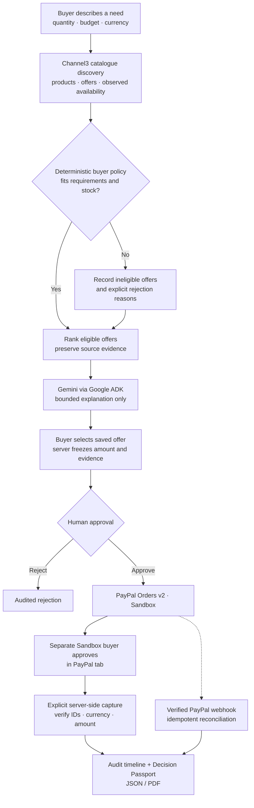
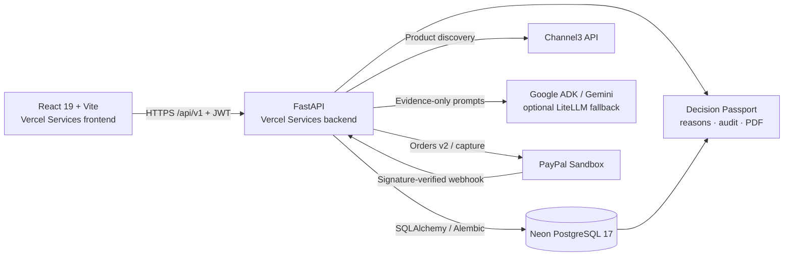
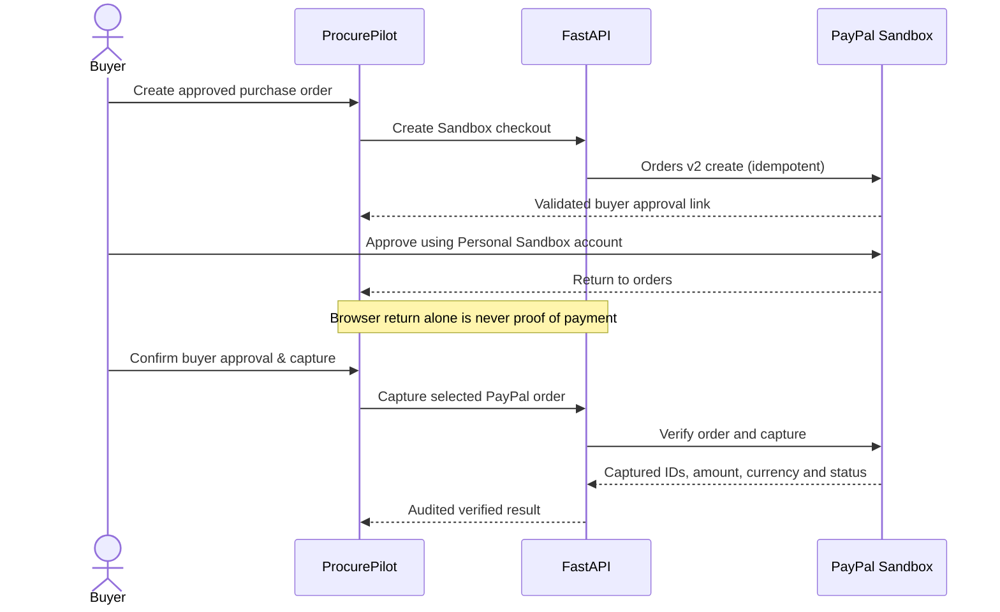

# ProcurePilot AI

**Every purchase has a reason.**

An accountable purchasing decision system built for the **PayPal AI Hackathon**. ProcurePilot brings together real product evidence, deterministic purchasing rules, bounded AI analysis, human approval, and verified **PayPal Sandbox** capture—then preserves the decision in a portable **Decision Passport**.

[**Launch application**](https://procurepilotai.vercel.app) · [**Judge guide**](docs/JUDGES_START_HERE.md) · [**Architecture**](docs/architecture.md) · [**Release acceptance**](docs/RELEASE_READINESS.md) · [**Security model**](docs/security.md) · [**Run tests**](qa/README.md) · [**MIT License**](LICENSE)

> **Demo boundary:** This is a hackathon prototype—not a production payment processor or retailer checkout. PayPal Sandbox does not move real money or pay Channel3 merchants. Public deployment readiness and real provider acceptance must be demonstrated separately from a successful code build.

---

## The problem

A purchasing decision must answer more than *“Which product is cheapest?”*

- **Fit:** Does the offer meet the buyer's actual specifications, currency, stock and budget?
- **Evidence:** Which alternatives were considered, and *why* were some rejected?
- **Authority:** Who approved the purchase and under which constraints?
- **Proof:** Was the PayPal test payment genuinely approved and captured—not merely redirected?
- **Accountability:** Can a reviewer reconstruct the decision later?

**ProcurePilot turns that fragmented process into one traceable workflow.** Its central distinction is deliberate: **AI explains; code validates; humans authorize; PayPal supplies Sandbox payment evidence.**

## Explore the project

| Start here | What you'll see |
| :--- | :--- |
| [**Web application**](https://procurepilotai.vercel.app) | React workspace, procurement form, approval queue, policy lab and order history. The frontend is deployed; do not infer API readiness from the landing page alone. |
| [**Judge walkthrough**](docs/JUDGES_START_HERE.md) | A guided path through the experience, with a separate no-credentials offline preview. |
| [**Decision Trust Lab**](docs/JUDGES_START_HERE.md) | Twelve labelled **synthetic** scenarios evaluated against the real deterministic policy code—no fake provider calls or payments. |
| [**Backend API**](docs/api.md) | Authenticated procurement, discovery, approvals, Sandbox payments and signed webhook routes. |

**Hosted acceptance status, November 7, 2026:** The last maintainer-reported seven-check probe passed the frontend and deep-link gates (**2/7**), while all API routes returned HTTP 500. Subsequent packaging deployments built successfully, but the complete live check has **not** been reported as passing. Treat the hosted end-to-end demonstration as **unverified** until the probe and real provider checks succeed.

## How a purchase moves through ProcurePilot



**Selection is never delegated to an LLM.** The backend enforces required attributes, buyer mandates, approved merchant constraints, HTTPS offer links, quantity, currency, stock and budget. It derives the purchase-order total from stored offer data rather than trusting browser-submitted prices.

An authorized reviewer must approve the purchase order before Sandbox checkout. Personal workspaces allow owner approval by default; an **independent registered reviewer** can be assigned to a specific order. This is not a claim of organization-wide RBAC.

## Architecture and trust boundaries



| Boundary | Responsibility |
| :--- | :--- |
| **Channel3** | Product IDs, retailer offers, observed price/stock/attributes; missing data stays unknown. |
| **Deterministic Python policy** | Reject ineligible offers; determine permitted order amounts and state transitions. |
| **Gemini / Google ADK** | Explain shortlisted evidence within input, output, timeout and daily-call limits; **no approval or payment tools**. |
| **Human reviewer** | Approve or reject a saved purchase order. |
| **PayPal Sandbox** | Separate Business seller REST app and Personal test buyer; explicit capture and signature-verified webhook evidence. |
| **Neon** | Durable users, requests, order snapshots, approvals, payments, audit entries, AI quotas and shared authentication-throttle counters. |

The **Decision Passport** records the selected offer, rejected alternatives, comparison basis, applicable policy, human actions and Sandbox capture evidence. A cheap but **ineligible** listing is not treated as realized savings. Tax, delivery, merchant fulfillment and real settlement are not verified.

### Payments are human-controlled



PayPal may also deliver webhooks to `/api/v1/webhooks/paypal`. The backend verifies signatures and correlates event/order/capture identities; duplicate or mismatched events must not create a second payment.

---

## Run locally

### Option A — Safe judge preview (no private provider keys)

Install **Python 3.12+**, **Node.js 22.12+** (or Node 20.19+) and Git. An internet connection is needed to install dependencies initially.

**Windows PowerShell**

```powershell
git clone https://github.com/PerezChris99/ProcurePilot-AI.git
cd ProcurePilot-AI
.\judge-preview.bat
```

**macOS / Linux**

```bash
git clone https://github.com/PerezChris99/ProcurePilot-AI.git
cd ProcurePilot-AI
python3 judge-preview.py
```

Open **http://127.0.0.1:5173**. The launcher builds the frontend and prepares an isolated local SQLite preview database. It does **not** overwrite your `.env`, connect to your Neon instance or perform real provider transactions.

To add clearly marked sample catalogue evidence for a registered preview account:

```powershell
.\judge-preview.bat --seed-email YOUR_REGISTERED_EMAIL
```

The `[OFFLINE SAMPLE]` demonstration is intentionally **non-payable** and cannot be represented as a real Channel3, Gemini or PayPal result.

### Option B — Full local development

Configure an uncommitted root `.env` with authorized credentials; follow [provider setup](docs/provider-setup.md). On Windows:

```powershell
.\start.bat
```

This uses the configured database and starts the application's development workflow. For a full run, provide Channel3 and Gemini credentials, PayPal Sandbox Business REST credentials, and a separate Sandbox Personal buyer. Never put credentials in source, screenshots, issues or public judging instructions.

## Verify before judging

**Local QA** — from the repository root:

```powershell
.\test-all.bat
```

**Live HTTPS acceptance** — from the repository root:

```powershell
python .\qa\live_demo_check.py --frontend https://procurepilotai.vercel.app --api https://procurepilotai.vercel.app
```

The seven read-only gates cover landing page, deep links, API liveness, database/schema readiness, CORS, protected order access and protected policy-lab access. **Require 7/7**, then separately verify live Channel3 discovery, a real bounded Gemini response, distinct PayPal Sandbox buyer approval, exact capture, and signed webhook delivery. Passing mocked Python/React tests or a Vercel build alone cannot substitute for these checks.

Useful detailed references: [QA matrix](qa/README.md) · [Provider acceptance](docs/INTEGRATION_ACCEPTANCE.md) · [Vercel + Neon runbook](docs/VERCEL_NEON_DEPLOYMENT.md) · [API reference](docs/api.md).

## Technical scope

- **Frontend:** React 19, JavaScript/JSX, Vite, React Router, TanStack Query and Recharts.
- **Backend:** Python 3.13 on Vercel, FastAPI, Pydantic, SQLAlchemy and Alembic.
- **Data:** Neon PostgreSQL 17 with shared rate-limit and AI-budget records; non-production preview uses isolated SQLite.
- **AI and commerce:** Google ADK/Gemini, bounded optional LiteLLM fallback, Channel3 catalogue API and PayPal **Orders v2 Sandbox**.
- **Controls:** Argon2id passwords, short-lived JWTs, per-user record ownership, shared production auth throttling, policy verification, independently approved order state, capture validation and audit events.

**Known limits:** No refresh-token rotation or password recovery, no enterprise-wide invitation/RBAC system, no real supplier checkout or fulfillment, no real-money capture, and no guaranteed live-model or catalogue availability. Hosting and operational readiness must be proved with live checks rather than inferred from code.

## Project structure

```text
frontend/                 React screens, forms, design, UI tests
backend/app/api/           Auth, procurement, approval, PayPal and webhooks
backend/app/agents/        Evidence-restricted Google ADK analysis
backend/app/procurement/   Deterministic constraints, ranking, passports
backend/app/integrations/  Channel3 and PayPal client boundaries
backend/alembic/           Versioned schema migrations
backend/tests/             Backend/API/security regression coverage
qa/                        Local test gates and hosted HTTPS probe
docs/                      Detailed architecture, security and judge notes
vercel.json                Same-origin Vercel Services routing
```

## Hackathon, ownership and attribution

Created for the [PayPal AI Hackathon](https://paypalaihackathon.devpost.com/). The submission requires a functional project, genuine PayPal + AI integration evidence, a documented repository, and a public demo video; see the [submission checklist](docs/HACKATHON_SUBMISSION_KIT.md).

**License:** [MIT](LICENSE) · [Copyright and attribution](NOTICE). ProcurePilot AI is an independent hackathon project and is not presented as an official PayPal, Gemini, Channel3, Neon or Vercel product.

**The principle:** *Every purchase has a reason—and the evidence to explain it.*
