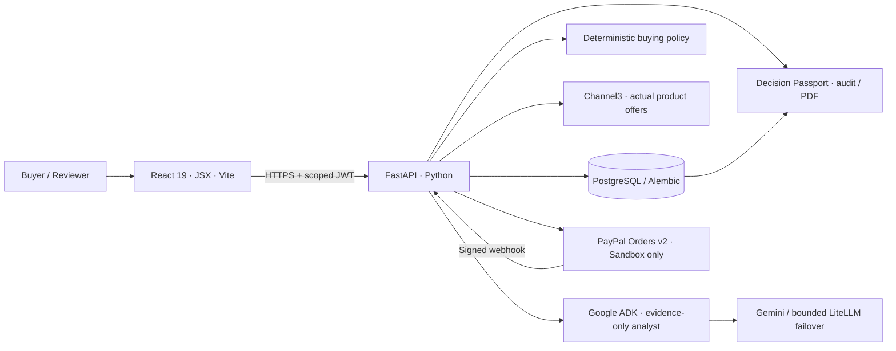

# ProcurePilot AI

**Every Purchase Has a Reason.**

*An evidence-first purchasing decision system that connects real catalogue offers, bounded AI reasoning, human authorization, and verified PayPal Sandbox payment evidence.*

[Start here: judge walkthrough](docs/JUDGES_START_HERE.md) · [Architecture](docs/architecture.md) · [Decision and security controls](docs/security.md) · [Automated QA](qa/README.md) · [Devpost submission kit](docs/HACKATHON_SUBMISSION_KIT.md) · [MIT License](LICENSE)

> **Hackathon prototype, not a production payment processor.** PayPal Sandbox captures are made against the configured test merchant; they **do not** pay Channel3 retailers, reserve inventory or move real money. AI cannot approve or pay. Delivery, taxes and seller settlement are not verified.

## The idea in 30 seconds

Buying a product is easy. **Defending the decision** is harder: Was the specification right? Was the offer in stock? What alternatives were rejected? Who approved the amount? Did the payment actually complete?

ProcurePilot AI keeps those answers together. A buyer describes a need, real Channel3 offers are screened by executable purchasing policy, Gemini explains the shortlist through Google ADK, a human approves the selected purchase order, and PayPal Orders v2 **Sandbox** demonstrates the buyer-approval and verified-capture lifecycle. A downloadable **Decision Passport** retains the source evidence and audit trail.

**Our distinction:** the model advises; deterministic Python rules decide eligibility; a person authorizes; verified PayPal evidence establishes the Sandbox payment outcome. No invented stock, no LLM-controlled payment, and no fake retailer settlement.

## Try it

| Path | For | How |
| --- | --- | --- |
| **Hosted full demonstration** | Judges evaluating real integrations | A public HTTPS URL and safe judging access will be added **only after deployment and live acceptance are verified**. No hosted URL is claimed yet. |
| **One-command local judge preview** | Judges who want to inspect the UI, create accounts and see truthful, non-payable catalogue samples without API keys | Follow the platform-specific commands below. This is a **labelled offline preview**, not a live PayPal/Channel3 demonstration. |
| **Full local integration** | Developers or judges with authorized test credentials | [Provider setup](docs/provider-setup.md) + [live acceptance](docs/INTEGRATION_ACCEPTANCE.md). Use real Channel3/Gemini credentials and separate PayPal Sandbox Business/Personal accounts. |

**Prerequisites for the local preview:** Git, Python **3.12+**, Node.js **22.12+** (or 20.19+) with npm, and internet access for the first dependency installation. PostgreSQL, Redis, VS Code and external API keys are **not required for the offline preview**.

**Windows — PowerShell**

```powershell
git clone https://github.com/PerezChris99/ProcurePilot-AI.git
cd ProcurePilot-AI
.\judge-preview.bat
```

**macOS / Linux — terminal**

```bash
git clone https://github.com/PerezChris99/ProcurePilot-AI.git
cd ProcurePilot-AI
python3 judge-preview.py
```

On the first run, the launcher checks runtimes, installs dependencies, runs **Alembic on its own local SQLite file**, builds React, and starts both servers in the current terminal. Open **http://127.0.0.1:5173** and choose **Get started**. Press **Ctrl+C** to stop. Rerun with `--skip-install` if dependencies are already installed.

The launcher does **not** edit your existing `.env`, connect to your configured PostgreSQL, or use your provider keys. It forces local preview settings in child-process environments.

**To view a representative catalogue after registering:** keep or restart the preview, open another terminal, and run:

```powershell
.\judge-preview.bat --seed-email YOUR_REGISTERED_EMAIL
```

On macOS/Linux, use `python3 judge-preview.py --seed-email YOUR_REGISTERED_EMAIL`. Refresh **Product discovery** and open the `[OFFLINE SAMPLE]` request. The sample visibly demonstrates matching, wrong-size rejection and out-of-stock handling; it **cannot** create payable purchase orders or simulate a successful AI/PayPal call.

**For actual checkout testing**, follow [Judges: start here](docs/JUDGES_START_HERE.md) and [Render hosting](docs/RENDER_DEPLOYMENT.md). Never publish provider secrets or Sandbox buyer passwords in this repository.

## What to show in a live five-minute walkthrough

1. **Describe a purchasing need.** Example: *Two 27-inch office monitors*, quantity **2**, budget **$1,000 USD**. Add explicit mandatory attributes or an assigned, registered independent approver if desired.
2. **Discover real offers.** Channel3 product IDs, seller URLs, prices, currency, availability and available specifications are saved with a timestamp. Listings that fail a required screen size, budget, stock or policy are visibly rejected.
3. **Ask AI to analyze.** Google ADK gives Gemini a short evidence packet. Transient model failures can route to bounded, quota-counted Groq/OpenRouter backups. If all models fail, the UI **labels a rule-based catalogue summary as non-AI**, with a retry action.
4. **Create a purchase order.** Select a policy-eligible offer. The server derives total = quantity × saved unit price and freezes the selected offer and alternative evidence; it never trusts a browser-supplied amount.
5. **Submit and approve.** A human must approve. Personal demo workspaces can self-approve; optional delegated approval can require a *different registered reviewer*.
6. **Go to PayPal Sandbox.** After approval, creating checkout opens the validated PayPal Sandbox buyer-approval URL in the same tab. A separate **Sandbox Personal buyer** approves; the user returns and explicitly confirms capture. The backend verifies order ID, currency, value and captured amount before recording `paid`.
7. **Inspect the Decision Passport.** Open the immutable selection snapshot, rejection and price comparisons, actor/timestamp trail, Sandbox payment evidence and PDF export.

*The exact products and prices depend on the live catalogue; the example above is an input scenario, not a claim that particular products or offers exist.*

## Decision Trust Lab: verify the rules, not just the story

From your signed-in dashboard, open **Decision Trust Lab** (`/trust-lab`).
Its **Run policy checks** action evaluates **twelve labelled synthetic
scenarios against the actual server purchase policy and verification predicates**.
It covers a valid offer; 72-inch versus 24-inch monitors; missing size proof;
monitor accessories; out-of-stock products; budget overflow; foreign currency;
unapproved merchants; insecure HTTP offers; expired mandates; unauthorized
delegated review; and altered PayPal order amounts.

The lab is read-only and does not invoke Channel3, Gemini or PayPal, create
purchase orders or run actual penetration tests. Results include the exact
observed rejection reason and expected outcome; no fabricated provider status.

The **Decision Passport** complements the lab with *real saved purchase
evidence* from eligible order creation: policy-blocked offer counts, the
cheapest eligible same-currency snapshot, the cheapest rejected listing and
why it was disqualified, the selected price premium and the human/PayPal
audit history. A cheap **rejected** item is never counted as realized
savings. Exports remain factual, owner-scoped and available as PDF/JSON.

[Technical acceptance and source-code proof](docs/LIVE_HOSTING_ACCEPTANCE.md)

## How it works



```mermaid
sequenceDiagram
    autonumber
    actor Buyer
    participant UI as React UI
    participant API as FastAPI
    participant C3 as Channel3
    participant ADK as Google ADK
    participant PP as PayPal Sandbox
    Buyer->>UI: State needs, quantity and budget
    UI->>API: Create procurement request
    API->>C3: Discover catalogue offers
    C3-->>API: Observed products and offers
    API->>API: Rank, verify constraints, save evidence
    UI->>API: Ask AI to analyze
    API->>ADK: Bounded, eligible evidence; no payment tools
    ADK-->>API: Assessment or transient failure
    API-->>UI: Explained ranking / clearly labelled fallback
    Buyer->>UI: Select eligible offer and create PO
    UI->>API: Submit for HUMAN approval
    Buyer->>UI: Approve as authorized reviewer
    UI->>API: Create PayPal Sandbox order
    API->>PP: OAuth / Orders v2 create
    PP-->>UI: Buyer approval link
    Buyer->>PP: Approve with separate Sandbox buyer
    PP-->>UI: Return to ProcurePilot
    Buyer->>UI: Confirm capture
    UI->>API: Verify remote order and capture
    API->>PP: GET order / capture with idempotency
    PP-->>API: Completed capture evidence
    API-->>UI: Verified status + auditable Decision Passport
```

### Where AI stops, and purchasing authority starts

| Concern | Source of truth |
| --- | --- |
| Product and stock evidence | Saved Channel3 catalogue responses, with timestamp and uncertainty |
| Offer eligibility | Deterministic Python: requested size, mandatory attributes, stock, HTTPS merchant link, currency, unit/total budget, buyer mandate |
| Procurement explanation | Gemini via Google ADK; up to two optional LiteLLM fallback models, **without order/payment tools** |
| Purchase selection | Authenticated buyer, exact saved offer; server-frozen amount and policy snapshot |
| Human approval | Authenticated owner or explicitly delegated registered reviewer |
| Buyer payment | PayPal **Sandbox** OAuth, Orders v2, explicit capture, verified amount/IDs and signed webhook reconciliation |
| Evidence after the event | Decision Passport with selected/alternative offers, policy reasons, audit entries and PDF export |

See [AI operation and quotas](docs/agent.md), [payment trust boundaries](docs/security.md) and [HTTP API](docs/api.md).

## Engineering and test evidence

**Maintainer-reported on Windows, November 6, 2026:** all **nine offline QA gates passed** after the screen-size regression fix. These are offline tests, **not** a claim of hosted availability or real third-party acceptance. Re-run after pulling the latest commit.

```powershell
.\test-all.bat
Get-Content .\qa\reports\summary.md
```

The suite covers Python syntax, backend Pytest with branch coverage (including the new 12-scenario Trust Lab and fact-based Passport comparisons), fresh/upgrade Alembic scenarios, Node compatibility, ESLint, React Vitest, frontend deployment contracts, strict Vite build and built-asset smoke checks. The report is generated locally and deliberately gitignored. Browser E2E, real PostgreSQL deployment, actual PayPal Sandbox buyer/capture and signed remote webhooks require **separate acceptance**.

After publishing a public HTTPS UI and API, run the read-only live hosting checker:

```powershell
python .\qa\live_demo_check.py --frontend https://YOUR-FRONTEND-HOST --api https://YOUR-API-HOST
```

It checks seven deployment/authorization gates: home, deep links, health,
database readiness, CORS, and protected Orders/Trust Lab access. This is **not**
a substitute for testing real provider calls and Sandbox captures.

**Stack:** React 19 + React Router + TanStack Query + Recharts; FastAPI + Python 3.12+ + SQLAlchemy + Alembic + PostgreSQL; Gemini / Google ADK + LiteLLM fallback; Channel3; PayPal Sandbox; optional Render Static Site/Web Service/managed database/Key Value.

**Limitations we will not hide:** A passing code suite does not prove external providers are available. Payment is a Sandbox test, not supplier fulfillment. Model-generated prose is not authority. Delivery/tax data are unverified. Public deployment, judge access and live integration proof remain external completion gates until verified.

## Hackathon and submission

Built for the [PayPal AI Hackathon](https://paypalaihackathon.devpost.com/), deadline **November 12, 2026, 12:00 PST / 23:00 EAT**. The project must meaningfully use PayPal and AI; the submission requires a functional demo, a public open-source repo, clear text/tool descriptions and a **public YouTube video under three minutes**.

- [Start here / judge access instructions](docs/JUDGES_START_HERE.md)
- [Devpost write-up, presentation storyboard and submission checklist](docs/HACKATHON_SUBMISSION_KIT.md)
- [Official judging scorecard and remaining work](docs/HACKATHON_FINAL_AUDIT.md)
- [PayPal Sandbox, Gemini and Channel3 live acceptance](docs/INTEGRATION_ACCEPTANCE.md)
- [Public HTTPS infrastructure readiness checks](docs/LIVE_HOSTING_ACCEPTANCE.md)
- [Render deployment runbook](docs/RENDER_DEPLOYMENT.md)

**License:** [MIT](LICENSE) · [Attribution and third-party notices](NOTICE). Independent hackathon prototype; use of third-party product/service names does not imply endorsement. No actual payment credentials, merchant credentials or buyer passwords belong in public source.

### Repository map

```text
frontend/                  React JSX, Vite, screens, accessibility tests
backend/app/api/            Authentication, procurement, human approvals, payments
backend/app/agents/         Google ADK, evidence limits, quota and model fallback
backend/app/procurement/    Deterministic policy, ranking, Decision Passport/PDF
backend/app/integrations/   Channel3 and PayPal clients
backend/alembic/            SQL migrations
backend/tests/             API and integration regressions (mocked providers)
qa/                        Nine-gate offline test/build runner + seven-check HTTPS probe
docs/                      Architecture, security, judge and deployment manuals
judge-preview.py / .bat     Isolated, intentionally non-payable judge preview
```

**Technology choice:** Source evidence, purchase policy, human approval and Sandbox payment proof are separate trust boundaries so that a useful AI explanation can never become an unchecked spending instruction.
